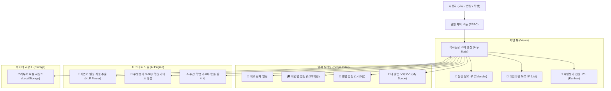

# 🏫 신성여고 AI 기반 학교 일정 통합 관리 시스템 (School Life AI Planner)

> **과목명**: 2026학년도 고등학교 인공지능 기초  
> **프로젝트명**: AI 기반 학교·학년·학급 통합 학사 일정 및 수행평가 플래너  
> **제작자**: 신성여자고등학교 2학년 10반 ㄱㅇㄹ  
> **🌐 GitHub Pages 배포 사이트**: `https://<깃허브-아이디>.github.io/shinseong-ai-planner/`  
> **🔗 GitHub 저장소 (Repository)**: `https://github.com/<깃허브-아이디>/shinseong-ai-planner`  
> **실행 파일**: [`index.html`](file:///c:/Users/성신여고-학생용22/OneDrive/Desktop/2026%20인공지능%20기초/21011ㄱㅇㄹ/index.html) 또는 단독 실행 파일 [`학교일정관리_앱_단독실행.html`](file:///c:/Users/성신여고-학생용22/OneDrive/Desktop/2026%20인공지능%20기초/21011ㄱㅇㄹ/학교일정관리_앱_단독실행.html)

---

## 1. 📌 개발 개요 및 목적 (Project Overview)

고등학교 학교생활은 **학교 전체 행사(정기고사, 축제, 방학)**, **학년별 행사(학력평가, 수련회, 전공탐색)**, 그리고 **학급별 일정(과목별 수행평가, 과제 마감일, 필수 준비물)**이 동시다발적으로 진행됩니다.  
기존의 종이 가정통신문이나 단순 메신저 공지는 일정이 파편화되어 학생들이 수행평가 제출 기한을 놓치거나 필요한 준비물을 챙기지 못하는 문제가 발생하기 쉽습니다.

본 시스템은 **"한눈에 보는 학교생활, 놓치지 않는 수행평가"**를 목표로 하여 다음과 같은 핵심 가치를 제공합니다:
1. **적용 범위별 엄격한 구분**: 학교 전체 / 특정 학년 / 특정 반별 일정 분리 및 통합 맞춤 조회
2. **역할 기반 권한 관리(RBAC)**: 교사(전체 권한), 반장(학급 권한), 학생(조회 및 개인 체크리스트)
3. **AI 스마트 도우미 탑재**:
   - **자연어 파싱(NLP)** 기반 일정 간편 등록 ("다음주 금요일 2학년 10반 인공지능 기초 수행평가 발표, 노트북 준비" 입력 시 자동 폼 완성)
   - **AI 수행평가 D-Day 맞춤형 학습 로드맵** 및 고득점 작성 팁 제공
   - **AI 주간 학습 부하(Workload) 및 일정 충돌 사전 경고** 시스템
4. **학생 실사용 편의 기능**:
   - D-Day 실시간 카운트다운 (D-Day, D-1 긴급 알림)
   - 인터랙티브 준비물 체크리스트 (체크 상태 및 달성률 영구 저장)
   - 월간 달력, 타임라인 목록, 수행평가 집중 보드 3가지 멀티 뷰 모드 지원

---

## 2. 🏗️ 시스템 아키텍처 및 화면 설계

---

## 3. ✨ 핵심 기능 설명

### 1) 적용 범위별 탭 및 다층 필터링
- **학교 전체 일정**: 접속 시 가장 먼저 표시되며, 수능 휴업일, 신성여고 개교기념일, 기말고사, 동아리 축제(신성 난향제), 방학식 등 전교생 공통 일정을 표시합니다.
- **학년별 일정**: 1학년, 2학년, 3학년 탭을 클릭하여 해당 학년의 학력평가(모의고사), 학년 행사만 선별 조회합니다.
- **반별 일정**: 학년과 반(1반~10반)을 선택하여 해당 반의 수행평가, 과제, 준비물, 학급 자치 일정을 집중적으로 확인합니다.
- **내 맞춤 일정 모아보기**: 현재 접속한 학생에게 해당하는 일정(학교 전체 + 본인 학년 + 본인 학급)을 자동으로 병합하여 나만의 통합 캘린더를 보여줍니다.

### 2) 사용자 역할 기반 권한 제어 (RBAC)
- **🧑‍🏫 교사 (학사관리자)**: 학교 전체, 학년별, 반별 모든 일정의 등록, 수정, 삭제가 자유롭습니다.
- **👑 반장 (학급 임원: 2학년 10반 반장)**: 자신이 담당하는 학급(2학년 10반)의 일정만 등록, 수정, 삭제할 수 있으며, 타 반이나 학교 전체 일정은 수정할 수 없습니다.
- **🎒 학생 (2학년 10반 학생)**: 일정을 안전하게 조회하고, 준비물 체크리스트를 체크하며 학업 관리에 집중할 수 있습니다. (등록 버튼 시 권한 안내)
- **실시간 역할 스위처**: 상단 헤더의 드롭다운에서 1초 만에 권한을 전환하여 각 사용자 시점의 UI와 동작을 검증할 수 있습니다.

### 3) 🤖 AI 스마트 도우미 (AI Features)
1. **자연어 일정 등록기 (Smart NLP Schedule Parser)**:
   - "다음주 금요일 2학년 10반 인공지능 기초 수행평가 발표, 노트북 준비"라고 입력하고 버튼을 누르면 AI가 제목, 일자, 학년, 반, 카테고리, 준비물을 스스로 추출하여 등록 폼을 자동으로 채워줍니다.
2. **AI 수행평가 D-Day 학습 가이드 (Study Roadmap)**:
   - 과목(예: 인공지능 기초, 문학, 수학 등)과 평가 방식에 맞춰 **D-7(자료수집/개요) -> D-3(본문/루브릭 교차검증) -> D-Day(오탈자/규격점검)**의 맞춤형 학습 로드맵과 고득점 작성 팁을 제공합니다.
3. **AI 주간 과부하/충돌 감지기 (Workload Detector)**:
   - 향후 7일간 수행평가나 시험이 2개 이상 중복되는 주간을 실시간 감지하여, 벼락치기를 방지하고 분산 학습을 할 수 있도록 안내 배지를 표시합니다.

---

## 4. 🌐 GitHub Pages 배포 가이드 (3분 완성)

본 프로젝트를 깃허브 웹사이트로 무료 호스팅하는 방법입니다:

1. **GitHub 로그인 및 새 저장소 생성**:
   - Repository name: `shinseong-ai-planner`
   - Public(공개)으로 설정 후 **Create repository** 클릭
2. **프로젝트 파일 업로드**:
   - `index.html`, `style.css`, `app.js`, `README.md` 파일을 업로드하고 Commit 합니다.
3. **GitHub Pages 활성화**:
   - 저장소 상단 메뉴의 **Settings** 클릭
   - 좌측 메뉴에서 **Pages** 클릭
   - **Build and deployment > Branch**를 `None`에서 `main` (또는 `master`) / `/(root)`로 변경 후 **Save** 클릭
4. **배포된 링크 확인**:
   - 1~2분 뒤 상단에 표시되는 `https://<아이디>.github.io/shinseong-ai-planner/` 링크를 통해 전 세계 누구나 접속할 수 있습니다!

---

## 5. 📂 파일 구성 안내

| 파일명 | 구분 | 설명 |
| :--- | :---: | :--- |
| **`index.html`** | 핵심 | 신성여고 AI 웹 애플리케이션 메인 HTML 구조 및 모달 레이아웃 |
| **`style.css`** | 디자인 | 부드러운 파스텔 톤의 학생 친화적 반응형 스타일시트 |
| **`app.js`** | 로직 | 데이터 관리, 권한 제어, 달력 렌더링, AI 파싱 및 체크리스트 엔진 |
| **`학교일정관리_앱_단독실행.html`** | 배포용 | HTML+CSS+JS가 하나로 통합된 단독 실행 파일 (인터넷 없이도 더블클릭 실행 가능) |
| **`README.md`** | 문서 | 프로젝트 포트폴리오 및 전체 아키텍처 기술 문서 (현재 파일) |
